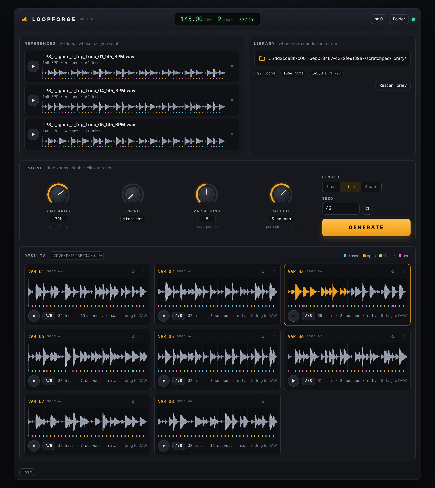

# Loopforge

Generate new, unique top loops (hats, shakers, percussion) from **your own** sample library,
in the feel of 1–3 reference loops you like. Everything runs locally on your computer.



## Start the app (no terminal needed)

1. On GitHub, click **Code → Download ZIP** and unzip it (or `git clone` it).
2. Open the folder and double-click:
   - **macOS:** `Start Loopforge.command`
     (if macOS says it can't be opened: System Settings → Privacy & Security → scroll down → **Open Anyway**;
     on older macOS: right-click → **Open**. Only needed once.)
   - **Windows:** `Start Loopforge.bat`
3. The first start installs what it needs (about a minute). Your browser then opens Loopforge.
   Keep the small black window open while you use it; close it to quit.

## Using it

1. **References** – drop 1–3 loops whose groove/sound you like (wav, aiff, flac).
2. **Library** – click the folder field and pick your loop library (sub-folders are included).
   The first scan analyses every loop once; later scans only look at new or changed files.
3. **Engine** – drag the knobs (scroll or arrow keys work too, double-click resets):
   - *Similarity*: high = close to your references, low = looser and more surprising
   - *Swing*: straight by default
   - *Variations*: how many loops per run
   - *Palette*: how many different samples per sound type (1 = one hat, 3 = main + variations)
   - *Length* and *Seed* (same seed + settings = the same loops again; ⚄ = random)
4. **Generate**, then click a waveform to loop it. **A/B** flips between the loop and your first
   reference in time. **★** saves it to your favourites. Drag a card straight into Ableton / FL Studio
   (Chrome or Edge), or use ⤴ to show the file.

Your files live in `~/Loopforge` (refs, every run, favourites). Each loop has a `.json` recipe next
to it that rebuilds it exactly.

## Command line (optional)

```bash
uv run loopforge index "/path/to/library"
uv run loopforge generate --refs a.wav b.wav --library "/path/to/library" --variations 8 --out ./out
uv run loopforge render out/var_01_seed42.json
uv run loopforge ui
```

See `CLAUDE.md` for design notes.
